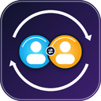

# Antigravity Account Switcher

<p align="center">
  
</p>

> **Visual Account Switcher & Profile Manager for Google Antigravity (IDE, Desktop 2.0, and CLI)**

[](LICENSE)
[](package.json)
[]()
[](https://github.com/ismaelsoilet/antigravity-account-switcher/actions/workflows/ci.yml)

An embedded extension and CLI utility that allows developers to seamlessly save, manage, and toggle between multiple Google accounts on the same computer without continuous browser re-authentication or session conflicts.

See [CHANGELOG.md](CHANGELOG.md) for the release history.

### What's new in 1.8.0-alpha.1

- **Custom extension icon:** an original 128×128 PNG (`assets/icon.png`) now identifies the extension in the Antigravity/VS Code Extensions view and the VSIX.
- **Keyring read-only detection:** diagnostics and the Doctor now read the Windows Credential Manager entry `gemini:antigravity` and show its email/token-presence metadata without printing token material. The keyring is **not written yet**; that is the next 1.8.0 milestone.
- **Master plan and keyring spec:** see [docs/MASTER-PLAN.md](docs/MASTER-PLAN.md) and [docs/SPEC-1.8.0-KEYRING.md](docs/SPEC-1.8.0-KEYRING.md) for the TOS-safe roadmap, keyring architecture and acceptance criteria.
- **Installer parity:** `install.sh` copies `assets/`, `README.md` and `CHANGELOG.md` into directory installs.

Previous 1.7.4: the read-only **Reliability Doctor**, helper-process filtering, Ubuntu/Windows CI and tagged VSIX releases.

### Product direction

The switcher is for **manual switching between accounts you own**, one active
account at a time. It does **not** run accounts in parallel, pool quotas, proxy
model traffic, auto-rotate on 429, auto-approve permissions or isolate
Antigravity instances. Quota display is read-only; the next action is always
yours. See [docs/MASTER-PLAN.md](docs/MASTER-PLAN.md).

---

## 🌟 Key Features

* **Visual Status Bar Indicator:**  
  Directly displays your active profile and Google email at the bottom of Antigravity IDE:
  ```text
  $(account) [Work] work@company.com
  ```
  When signed out or without active credentials, displays:
  ```text
  $(account) [No Account] Sign In
  ```
  *Hovering displays account metadata, profile label, vault storage status, and synchronization info.*

* **Safeguarded Account Switching with Confirmation Dialog:**  
  Prevents accidental switches during active work. Selecting a profile opens a modal confirmation with a reload alert. Upon confirmation, Antigravity IDE immediately applies the session and reloads.

* **Streamlined New Account Flow with Auto-Reload:**  
  When adding a new Google account:
  1. Displays an explanatory confirmation dialog.
  2. Opens Google OAuth in your default browser.
  3. Waits for a fresh token, offers **Switch All & Reload**, writes the new account to the IDE, Desktop and CLI, and reloads only after every store converges.

* **Strict Session Gating (Zero Phantom Accounts):**  
  Validates that a token is usable (a non-expired access token or a refresh token) and never infers a session from historical SQLite onboarding keys. Manual registration only works while a real OAuth token exists and the email matches the token owner.

* **Conflict Detection Instead of Auto-Switching:**
  Every token file and every `state.vscdb` is inspected independently. If two surfaces disagree (for example, the IDE standalone token says account A while the CLI token says account B), or if one database contains two different identities (`antigravityAuthStatus.email` vs `lastLoginUsername`), the status bar shows a warning with the divergent stores and the switcher **does not** flip accounts, prompt in a loop, or overwrite the other surface automatically.

* **Atomic, Verified Switching:**
  A switch captures the current files and database keys, writes the target profile, re-reads every store to verify it converged, and only then reloads the window. If any store fails (for example, a locked database), the previous state is restored. Database auth keys that the profile does not contain are **preserved**, never deleted.

* **Same-Account Refresh Tolerance:**
  Antigravity refreshes tokens hourly. A refresh that keeps the same email is ignored; only a different email or a missing store produces a conflict warning.

* **Canonical Vault Format:**  
  Profiles saved by the CLI (`switch.py`) and the extension (`tokenManager.js`) use the same normalized format. Legacy `cli_token` / `standalone_token` / `oauth_creds` keys are migrated automatically.

* **Local Vault Hardening:**  
  The vault and token files are written atomically with `0600` permissions. The previous vault is preserved as `antigravity_profiles.json.bak`, and corrupt vaults are preserved as `.corrupt-<timestamp>.json` instead of being silently discarded.

* **Built-in Diagnostics:**  
  Run **Antigravity: Show Account Switcher Diagnostics** or `agy-switch diagnostics` to print detected database paths, token paths, runtime support and vault warnings.

* **Reliability Doctor:**
  Run **Antigravity: Run Account Switcher Doctor** or `agy-switch doctor` to detect running surfaces whose main process predates the last switch (the usual cause of a token being rewritten), duplicate main surfaces, store conflicts and unsafe file modes. The Doctor never writes to tokens, databases or profiles.

* **Dual-Host Support (Windows & WSL Remote Workspaces):**  
  Configured with `"extensionKind": ["ui", "workspace"]` to function smoothly whether working on local Windows folders or remote WSL (`wsl+ubuntu`) workspaces.

* **Unified Master Controller:**  
  Switching an account in the IDE automatically synchronizes across all surfaces:
  * **Antigravity IDE** *(active immediately after reload)*
  * **Antigravity 2.0 Desktop App** *(active on restart)*
  * **Terminal CLI (`agy`)** *(active immediately)*

* **Dedicated CLI (`agy-switch`):**  
  Full terminal control for power users, scripts, and terminal workflows.

---

## 💡 Architecture & How It Works

### Unified State Sync (USS)
Google Antigravity utilizes **Unified State Sync (USS)** (`antigravityUnifiedStateSync`) across its desktop surfaces:
1. **Unified Authentication:** The current Antigravity builds keep the live OAuth token in the per-surface token files (`jetski-standalone-oauth-token` and `antigravity-cli/antigravity-oauth-token`) and the account identity in `antigravityAuthStatus` / `google.google-antigravity` inside `state.vscdb`. Older builds also used `antigravityUnifiedStateSync.oauthToken` and related keys; they are captured when present but are no longer required.
2. **Shared Local Daemon:** Antigravity IDE, Antigravity 2.0 Desktop, and the CLI share a local language server daemon and can run on both Windows and WSL, which means the same logical token can exist in up to four copies (IDE/Desktop × WSL/Windows) plus two databases.
3. **Session Vault:** The switcher stores profiles in `antigravity_profiles.json`, keyed by Google email and protected by owner-only permissions (`0600`). Writes are atomic and keep a `.bak` of the previous vault. The vault is **not encrypted**; it relies on filesystem permissions. Each profile records its database keys per database path (`db_tokens_by_path`). When switching, the extension writes the token files and the database identity, verifies every store, records the expected hashes in `antigravity_switch_state.json`, and then reloads the window.

### Multiple Instances and Conflicts

The switcher is designed for **one account at a time** across all surfaces. With the IDE, Desktop 2.0 and the CLI open at the same time, each process keeps its own copy of the OAuth token and may refresh it independently (the CLI refreshes roughly every hour). The switcher cannot force three running processes to keep three different accounts; any tool that writes the shared token files will win the last write.

What v1.8.0-alpha.1 does instead:

* runs a cross-process lock (`~/.gemini/.antigravity-switch.lock`) so two switches cannot interleave;
* records the expected identity and hashes in `~/.gemini/antigravity_switch_state.json`;
* polls the four token copies and the two databases every 5 seconds (file watch events on `/mnt/c` are unreliable);
* ignores same-email token refreshes;
* shows a **conflict warning** naming the divergent store instead of switching automatically.

The status bar prefers the surface selected by `antigravityAccountSwitcher.preferredStore` (`standaloneToken` by default, or `cliToken`), and always prefers the account most recently applied by the switcher while that store still exists. It never chooses a winner by modification time.

### Identity rules (v1.8.0-alpha.1)

* Gmail aliases are canonicalized for comparisons: `user+tag@gmail.com` and `u.ser@gmail.com` collapse to the same canonical address. The original email is still used when writing tokens.
* Each profile stores an `account_id` and a refresh-token fingerprint per token category. Profiles that share a canonical email or a fingerprint are **merged into one** (with `aliases`) instead of creating a second entry.
* A profile menu entry shows its aliases. Labels are unique; a duplicate label is automatically suffixed (`Work 2`).
* A `state.vscdb` is only considered a valid identity when `antigravityAuthStatus.email` and every `lastLoginUsername` / `jetski.onboarding.lastLoginUsername` agree. If they differ, the status bar reports `database-identity-mismatch` and saving/switching is blocked until the account is repaired (apply a profile or sign in again).
* Manual registration requires the typed email to match a token or database identity. It cannot invent an email when the active token belongs to another account.
* The sign-in flow waits for a **fresh token** (mtime after the sign-in started and a new fingerprint or email); a refresh from another surface no longer counts as a successful login. After the user confirms, it applies the new account to every store.
* After every successful switch, the target profile's metadata is refreshed (fingerprints, `account_id`, `db_tokens_by_path`, `complete`). Legacy profiles therefore repair themselves the first time they are applied.

When saving while another surface is still on a different account, the save is blocked with an explicit conflict message. To complete a login instead, use **Connect / Sign In to Google Account** or `agy-switch adopt`; for an already-saved profile, use **Reapply target profile** in the menu.

To use three different accounts simultaneously, each surface must run with an isolated profile/data directory. That is not implemented in v1.8.0-alpha.1; see [docs/MASTER-PLAN.md](docs/MASTER-PLAN.md) for why full isolation is not the next core feature.

### Reliability Doctor

The Doctor is the first thing to run when an account appears to flip back after a
switch:

```bash
agy-switch doctor
agy-switch doctor --json
```

It lists the main Antigravity surfaces (`desktop-wsl`, `ide-wsl`, `desktop-win`,
`ide-win`, `agent-hub`, `cli`), their PIDs and start times, and marks any surface
whose process started **before** the last switch. A surface that predates the
switch is still holding the previous refresh token in memory; restart/reload that
surface (or sign in again) before applying the profile again. The Doctor also
reports duplicate main surfaces, store conflicts, keyring/active mismatches and
group/other-readable files in the WSL home. It never modifies state.

### Conversation & Chat Sync
* Conversation history is stored in local SQLite databases (`conversation_summaries.db`).
* **In Antigravity IDE:** The sidebar chat list automatically scopes conversations to the currently active workspace directory (`workspace_uris`).
* **In Antigravity 2.0 Desktop:** The left sidebar displays conversations globally across all projects.

---

## 🛠️ Usage Guide

### A. From Antigravity IDE (Visual UI)

1. **Status Bar Menu:**  
   Click the account item in the bottom-right status bar:
   ```text
   $(account) [Work] work@company.com
   ```

2. **Switching Accounts:**
   * Select any saved profile from the list (e.g., `[Personal] personal@example.com`).
   * Confirm the prompt: **`Switch & Reload`**.
   * The window reloads with the selected account active across all surfaces.

3. **Resolving a Conflict:**
   * If the status bar shows a conflict, open the menu and choose **`Reapply [label] email`** under **CONFLICT RESOLUTION**. This writes the target account to every token file and database.
   * If the conflict is a newly signed-in account, choose **`Use newest login: email`** instead.
   * Reload/restart the surface named as divergent if the conflict returns; it is still signed in as the other account.

4. **Connecting a New Account:**
   * Click **`Connect / Sign In to Google Account...`**.
   * Complete Google Sign-In in your browser.
   * Confirm **`Switch All & Reload`**; the new account is written to the IDE, Desktop and CLI, and the profile is saved.

5. **Saving an Active Account:**
   * Click **`Save Active Account...`** to store the current session into the vault under a custom label (e.g., `Work`, `Personal`, `Contractor`).
   * If the stores disagree, saving is blocked with the full conflict detail. Resolve it first or use the login/reapply flow.

6. **Logging Out:**
   * Click **`Log Out Current Account...`** to disconnect the session without deleting your saved profiles.

7. **Resetting Data:**
   * Click **`Reset / Clear All Switcher Data...`** to perform a clean factory reset of the vault and session data.

8. **Diagnostics:**
   * Click **`Show Diagnostics`** to print paths, runtime support and vault warnings to the "Antigravity Account Switcher" output channel.

9. **Doctor:**
   * Click **`Run Doctor (surfaces, conflicts, permissions)`** to detect running main surfaces that predate the last switch, duplicate main surfaces, store conflicts and unsafe file modes.
   * The JSON report is written to the output channel. Use it when an account flips back after a switch.

---

### B. From the Terminal (`agy-switch` CLI)

```bash
# List all saved profiles and highlight the active account
agy-switch list

# Display the currently active session
agy-switch current

# Save the currently active session as a named profile
agy-switch save "Work"

# Switch active account by email or friendly label
agy-switch load "Personal"
# or
agy-switch load "work@company.com"

# Complete a fresh login: apply the newest token for an account to every surface
agy-switch adopt "work@company.com"
agy-switch adopt "work@company.com" --label "Work Laptop"

# Remove a specific profile from the vault
agy-switch delete "OldProfile"

# Factory reset: clear all profiles and active session tokens
agy-switch clear

# Inspect paths, runtime support and vault warnings
agy-switch diagnostics

# Diagnose running surfaces, stale processes, conflicts and file modes
agy-switch doctor
agy-switch doctor --json

# Print the CLI version
agy-switch --version
```

`agy-switch save` only snapshots a real active session. If the token has no embedded email, pass `--email user@example.com`; an email that does not match the active token is rejected.

`agy-switch load` refuses an incomplete profile and applies a saved profile. `agy-switch adopt` is for a **fresh sign-in**: it finds the newest token file for that account, writes it to all four token copies and both databases, verifies the result, and saves/refreshes the profile. Use it after signing in outside the extension when the other surfaces still show the old account.

---

## 📦 Installation

### Method 1: Using the Automated Installer (Recommended)

From the cloned repository directory:

```bash
./install.sh
```

The installer auto-detects the Windows home (or honours `ANTIGRAVITY_WIN_HOME`), installs into the Windows IDE and WSL server extension folders, removes duplicate/older copies of this extension, and installs the CLI as a real file in `~/.local/bin/agy-switch`.

Preview every action first:

```bash
./install.sh --dry-run
```

The directory copy is the actual installation. If you also want the server CLI to register the VSIX, add `--register-vsix` (some Antigravity server builds crash after registering; the copy still works).

Then reload Antigravity IDE (`Ctrl + Shift + P` → `Developer: Reload Window`).

### Method 2: Installing the VSIX Package Directly

1. In Antigravity IDE, open the Command Palette (`Ctrl + Shift + P`).
2. Type and select **`Extensions: Install from VSIX...`**.
3. Select `antigravity-account-switcher-1.8.0-alpha.1.vsix` located in the repository folder.
4. Reload the window when prompted.

To rebuild the VSIX from source:

```bash
npm run package
```

---

## 🔐 Security & Data

* The vault is **not encrypted**. It is protected by filesystem permissions (`0600`) and must never be committed to Git; the repository `.gitignore` already excludes it.
* The vault stores OAuth access and refresh tokens for every saved account, plus the Antigravity auth status. Treat `~/.gemini/antigravity_profiles.json` as a secret.
* Before each save, the previous vault is copied to `antigravity_profiles.json.bak`. A corrupt vault is preserved as `antigravity_profiles.json.corrupt-<timestamp>.json` instead of being silently discarded.
* Switching accounts writes the target profile's token files and database identity. Database auth keys that the profile does not contain are preserved; token file categories absent from the profile are still removed. If a store cannot be written or verified, the previous state is restored.
* On Windows/WSL, permission enforcement is best-effort. Do not share the Windows user profile with untrusted local users.

---

## 🧪 Testing

```bash
npm test
```

The suite is hermetic: it uses temporary homes and temporary SQLite databases, and never touches your real Antigravity session. The Node tests require `node:sqlite` (Node 22.13+ or Antigravity's bundled runtime); the Python tests use the standard library only.

---

## 🩺 Troubleshooting

* **Status bar says "Email not detected":** a token exists but has no email claim. Use **Register Email for Active Session** (only accepted when it matches the active token) or sign in again.
* **Database sync unavailable:** the host does not expose `node:sqlite`. Antigravity 1.107+ does; older or embedded hosts may not. Use **Show Diagnostics** to confirm.
* **A switch reports a failure:** the extension does not reload silently on errors. Check the "Antigravity Account Switcher" output channel; when a write fails, the previous session is left intact.
* **The account flips back after a switch:** run `agy-switch doctor`. The report names the surface whose main process started before the last switch; restart/reload it (or sign in again) before reapplying the profile. This is usually the IDE/Desktop/CLI process that still holds the old refresh token.
* **Recovering a profile:** if a vault was corrupt, inspect the generated `.corrupt-*.json` backup before importing it manually.
* **The CLI cannot find the databases:** run `agy-switch diagnostics`. On non-WSL Linux/macOS, database paths are discovered only where Antigravity actually stores `state.vscdb`; file-token switching still works.

---

## 📄 License

This project is open-sourced under the [MIT License](LICENSE).
